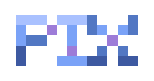

<p align="center">
  
</p>

# pix-9router

Pi extension with a 9Router model provider.

Other 9Router features live in separate packages. Each one reuses
`NINEROUTER_URL` and `NINEROUTER_KEY`:

- Speech tools (`transcribe`, `speak`, `/stt`) moved to `@xynogen/pix-voice` in
  0.7.0. Pick `9router` as the provider in its `/voice` command.
- Web search and fetch live in `@xynogen/pix-web`.

## Environment

Use the upstream standard names:

```bash
export NINEROUTER_URL="https://your-router.example.com"
export NINEROUTER_KEY="your-key-here"
```

Legacy aliases remain supported:

```text
ROUTER_API_BASE
ROUTER_API_KEY
```

The standard names win when both sets exist. There is no default URL: the provider
stays unconfigured until `NINEROUTER_URL` (or `ROUTER_API_BASE`) is set.

Classifier models (`jev`, `span`, `solar-decide`, `classifier`) register as
System One classifiers, not chat models. Add more ids with a comma-separated list:

```bash
export NINEROUTER_CLASSIFIER_MODELS="custom-judge,my-verifier"
```

## Install

```bash
pi install npm:@xynogen/pix-9router
```

> Standalone and opt-in. [`@xynogen/pix-core`](https://www.npmjs.com/package/@xynogen/pix-core) does not bundle it. It needs a 9Router API key.

## Full distro

This package is part of [Pix](https://github.com/xynogen/pix-mono). The installer sets up Pi and the full distro. See [Install](https://github.com/xynogen/pix-mono#install) for the notes for each OS.

```bash
# Linux / macOS
curl -fsSL https://raw.githubusercontent.com/xynogen/pix-mono/main/scripts/install.sh | sh
```

```powershell
# Windows
irm https://raw.githubusercontent.com/xynogen/pix-mono/main/scripts/install.ps1 | iex
```

## License

MIT. See [LICENSE](LICENSE).
