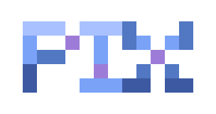

<p align="center">
  
</p>

# pix-commands

Pi extension providing focused slash commands:

- `/clear` — flush Pi's cached model data.
- `/btw [--no-ctx] <question>` — ask a side question without interrupting the main agent. It sees recent main-session turns by default (`--no-ctx` runs it fully isolated).

## `/clear`

Deletes `~/.cache/pi` and the jiti transpile cache (`<tmpdir>/jiti`) to flush stale model data and compiled extensions. Other files in the temp dir stay. A confirm dialog lists the exact paths first. Choose **Delete** to go on, or **Cancel** / `esc` to stop. After it deletes, it prompts you to run `/reload`. Without a TUI (headless or RPC) it deletes with no prompt.

## `/btw`

`/btw` runs a separate in-memory child session concurrently with the main agent:

```text
/btw given what we just did, what should I test first?
/btw --no-ctx what is the difference between a mutex and a semaphore?
```

Run `/btw` with no question to print usage. The live
above-editor widget lingers finished asides for `collapse.delaySec × 3` (errors
`× 9`), so a fire-and-leave aside stays visible while you are away; the durable
answer card in the log never expires.

The child session:

- starts a fresh in-memory session with a lean Pix system prompt;
- snapshots the main session's model, thinking level, active tools, credentials, extensions, and working directory;
- gets the last 10 main-session turns as a one-shot, read-only text preamble (user and assistant text only, tool output dropped). It is still a fresh in-memory session, and nothing goes back to the main thread. Pass `--no-ctx` to send no main conversation;
- publishes its Markdown answer in a visually distinct side-thread card;
- keeps rendered BTW answers out of future main-agent LLM context;
- supports multiple concurrent side questions.

When the main agent is streaming, completion is shown as a notification and the durable card is appended after the main session becomes idle. This prevents the side answer from becoming steering input.

## Install

```bash
pi install npm:@xynogen/pix-commands
```

> Bundled in [`@xynogen/pix-core`](https://www.npmjs.com/package/@xynogen/pix-core). Install it alone only if you do not use pix-core.

## Full distro

This package is part of [Pix](https://github.com/xynogen/pix-mono). The installer sets up Pi and the full distro. See [Install](https://github.com/xynogen/pix-mono#install) for the notes for each OS.

```bash
# Linux / macOS
curl -fsSL https://raw.githubusercontent.com/xynogen/pix-mono/main/scripts/install.sh | sh
```

```powershell
# Windows
irm https://raw.githubusercontent.com/xynogen/pix-mono/main/scripts/install.ps1 | iex
```

## License

MIT. See [LICENSE](LICENSE).
